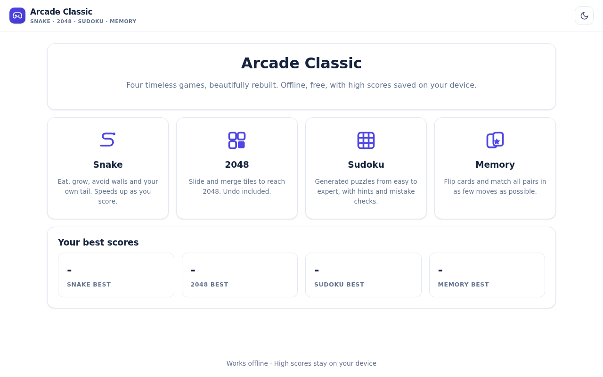
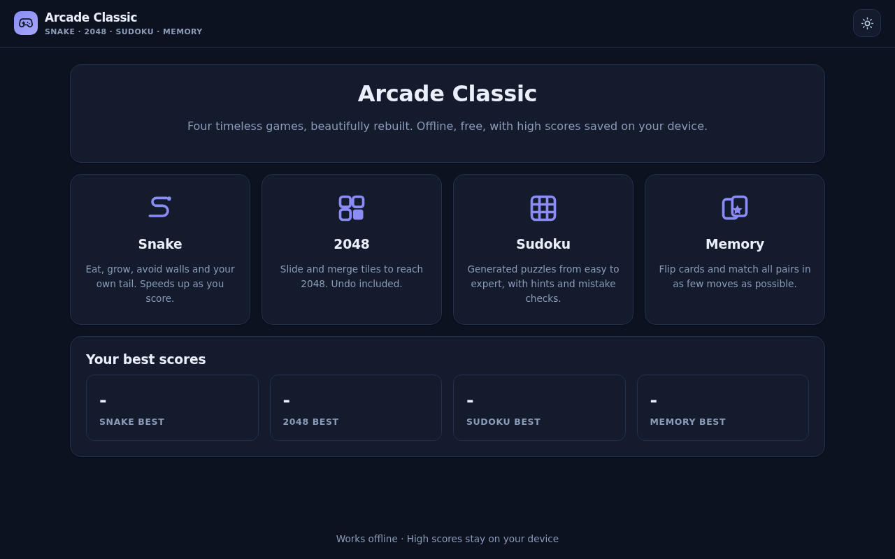
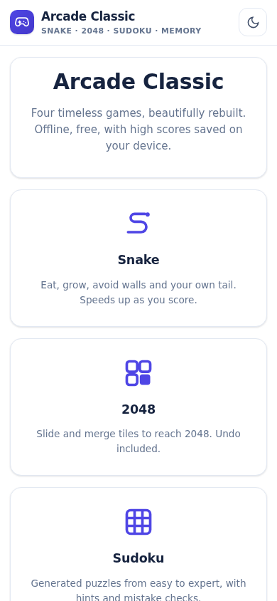

# Arcade Classic - Games Pack

Four polished classics in one app: Snake, 2048 with undo, Sudoku with a unique-solution generator, and Memory match.

**Live:** https://akash991833.github.io/classic-games-pack/

## Screenshots

| Desktop (light) | Desktop (dark) | Mobile |
| --- | --- | --- |
|  |  |  |

## Features

- Snake: canvas-rendered, swipe and on-screen d-pad
- 2048: smooth slides, undo, best score
- Sudoku: generator with guaranteed unique solutions, 4 difficulties, notes, hints, mistake limits
- Memory: themed glyph cards, move and time tracking
- Per-game best scores saved locally
- Dark and light themes, offline PWA

## Tech

Vanilla HTML/CSS/JS - no build step, no dependencies, no tracking. Installable PWA with a service worker, works fully offline. All data stays on your device.

## Run locally

Open `index.html` in a browser, or serve the folder with any static server:

```bash
npx serve .
```

## Honest limits

All logic is local; best scores persist per browser.
